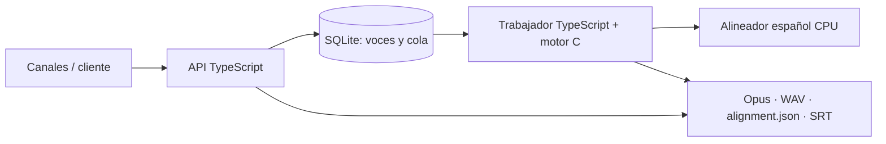

# self-hosted-tts

Servicio privado de narración en español para varios canales: voces clonadas seleccionables, velocidad y volumen, cola persistente, audio Opus/WAV y alineación por carácter con el formato habitual de ElevenLabs.

El motor es [gabriele-mastrapasqua/qwen3-tts](https://github.com/gabriele-mastrapasqua/qwen3-tts), fijado a una revisión concreta. Usa Qwen3-TTS **1.7B Base** para extraer cada perfil y **1.7B CustomVoice** para sintetizarlo con `--icl-only`. La expresividad por etiquetas queda fuera de v1: se rechaza en lugar de leerla o ignorarla silenciosamente.

## Arquitectura



Hay un único trabajador de cálculo activo, con reservas renovables y checkpoints por fragmento. El proceso C carga el perfil seleccionado en cada fragmento; se acepta su coste de carga para poder cambiar de voz sin modificar el motor. Síntesis y alineación se ejecutan en serie. El objetivo es producción por lotes; no se promete generación en tiempo real.

## Requisitos y arranque ARM64

La imagen del trabajador requiere **Linux ARM64 con ARMv8.2 y DOTPROD**, como Oracle Ampere A1. El código TypeScript y Python también se puede desarrollar en macOS; para las pruebas locales se utiliza un ejecutable C del host. Docker y Compose son necesarios en el servidor. Reserva unos 20 GB libres para modelos, construcción y primeros resultados, además de espacio para narraciones retenidas. El inicializador añade TTS_UID y TTS_GID a .env para ejecutar los contenedores con el usuario dueño de los volúmenes.

```sh
git clone https://github.com/jmcamposdev/self-hosted-tts.git
cd self-hosted-tts
cp .env.example .env
python3 scripts/init-secret.py
python3 scripts/download-tts-models.py
docker compose build
python3 scripts/download-align-model.py
docker compose up -d
docker compose ps
```

`/health/live` comprueba la API. `/health/ready` exige trabajador activo y alineador cargado. El arranque normal es offline; los modelos se descargan en un paso explícito. Los pesos TTS se comprueban mediante SHA-256 y revisiones fijadas. Los dos modelos comparten el códec para ahorrar disco. Los archivos de voz y las claves no se incluyen en Git ni en las imágenes.

La API escucha en **127.0.0.1:8080**. Para usarla desde otra máquina, emplea un túnel SSH o un proxy HTTPS autenticado hacia ese puerto. `/docs` presenta la documentación interactiva y permite introducir una clave Bearer; la documentación no contiene secretos.

## Crear una voz y narrar

La referencia debe contener 5–30 segundos de voz limpia, en un archivo de hasta 25 MB. No hace falta transcribirla para el perfil utilizado por v1. Usa referencias cuya utilización tengas autorizada.

```sh
python3 scripts/client.py voice-create --name Narrador --audio referencia.wav --wait
python3 scripts/client.py voices
python3 scripts/client.py narrate --voice-id VOICE_ID --text-file narracion.txt \
  --speed 1.08 --wait --output ./descarga
```

El cliente lee `.secrets/api_key` sin imprimir la clave. Con `--url` y `--key-file` puedes elegir otro servidor o archivo de clave. Si se interrumpe el cliente, retoma la consulta con `wait JOB_ID --output ./descarga`; el trabajo vive en el servidor.

El resultado contiene `audio.opus`, `audio.wav`, `alignment.json`, `words.json`, `subtitles.srt` y `metadata.json`. Caduca a los siete días; las voces y referencias persisten hasta borrarlas. Las descargas también exigen autenticación.

## API

Se autentica con `Authorization: Bearer CLAVE` o `xi-api-key: CLAVE`. Todas las rutas `/v1` requieren clave. Las rutas de salud y documentación son públicas y no revelan contenido.

| Método y ruta | Función |
|---|---|
| `POST /v1/voices` | Multipart con `name`, `audio` y opcional `voice_settings` como JSON. Devuelve 202, `voice_id` y `job_id`. |
| `GET /v1/voices` | Catálogo y disponibilidad. |
| `GET/PATCH/DELETE /v1/voices/{id}` | Consultar, configurar o borrar la voz. No se borra mientras tenga trabajos activos. |
| `POST /v1/text-to-speech/{voice_id}` | Encolar narración, devuelve 202 y `job_id`. |
| `GET /v1/jobs/{id}` | Estado, fase, progreso, intentos y errores. |
| `POST /v1/jobs/{id}/cancel` | Cancelar trabajo pendiente o activo. |
| `GET /v1/jobs/{id}/result` | Resultado con rutas de descarga relativas. |
| `GET /v1/jobs/{id}/artifacts/{name}` | Descargar uno de los seis artefactos permitidos. |
| `DELETE /v1/jobs/{id}` | Eliminar resultados o solicitar cancelación y borrado. |

Ejemplo de cuerpo para generar:

```json
{
  "text": "En el invierno de 1945, ocurrió algo inesperado.",
  "voice_settings": {"speed": 1.08, "volume": 1.0, "paragraph_pause_ms": 250, "seed": 42}
}
```

`Idempotency-Key` evita duplicar una narración si se repite la misma petición. Reutilizar la clave con otro texto o ajustes produce 409. Los ajustes se capturan al encolar; editar la voz después no cambia trabajos ya creados.

| Ajuste | Rango / valor inicial |
|---|---|
| `speed` | 0.8–1.25 / 1.08; WSOLA preservando el tono |
| `volume` | 0.5–1.5 / 1.0; ganancia con limitador antes de alinear |
| `paragraph_pause_ms` | 0–2000 / 250 |
| `seed` | Entero opcional 0–2147483647; se conserva en metadatos |

Temperatura fija 1.0, INT8 y un único idioma: español. No hay controles ficticios de estabilidad o similitud. No se admiten etiquetas entre corchetes. Una narración usa una voz; cambiar dentro del mismo texto queda fuera de v1. Límite: 30.000 caracteres, palabras de hasta 300 caracteres, y 30 minutos de salida; si se supera la duración se falla sin entregar un audio cortado como completo.

## Alineación y compatibilidad

`alignment.json` mantiene exclusivamente los tres campos siguientes:

```json
{
  "characters": ["H", "o", "l", "a"],
  "character_start_times_seconds": [0.10, 0.15, 0.20, 0.25],
  "character_end_times_seconds": [0.15, 0.20, 0.25, 0.30]
}
```

Los tiempos del ejemplo son ilustrativos. Los resultados reales usan [Wav2Vec2 español](https://huggingface.co/jonatasgrosman/wav2vec2-large-xlsr-53-spanish) y [CTC segmentation](https://github.com/lumaku/ctc-segmentation) sobre el audio **después de aplicar velocidad y volumen**, con copia a 16 kHz para el alineador. Cada fragmento se alinea por separado y sus offsets se suman con el número real de muestras, incluidas las pausas.

Los arrays reconstruyen el texto original exactamente, con espacios, puntuación y saltos de línea. Los números enteros, decimales y fechas `dd/mm/aaaa` se expanden antes de sintetizar, con un mapa al original. Escribe separadores de millares, abreviaturas o pronunciaciones ambiguas como palabras: `1.000` se interpreta como decimal, no como mil.

Puntuación y espacios no tienen sonido independiente. Sus tiempos se derivan de vecinos. Los caracteres de una cifra se distribuyen dentro del intervalo acústico de su expansión. `metadata.json` identifica esas posiciones derivadas y la resolución/confianza del alineador. No se promete la precisión propietaria de ElevenLabs ni se reemplaza un fallo por tiempos distribuidos artificialmente por toda la narración.

Si la alineación falla, el trabajo no se presenta como completo. Se conservan fragmentos para recuperar errores transitorios. Esta API se parece a ElevenLabs en conceptos y formato del alignment; no es un sustituto directo de su SDK síncrono o su endpoint con `audio_base64`.

## Desarrollo y validación

```sh
npm ci
npm run build
npm test
python3.11 -m venv .venv
.venv/bin/pip install -r alignment_service/requirements.lock.txt
npm run test:python
```

Para desarrollo local, configura `API_KEY_FILE`, `DATA_DIR`, `BASE_MODEL_DIR`, `CUSTOM_MODEL_DIR`, `QWEN_BINARY`, `QWEN_CWD` y `ALIGNER_URL` en el entorno. `DATA_DIR` debe ser una ruta absoluta compartida por los procesos. Inicia el alineador con `ALIGN_MODEL_DIR=models/alignment .venv/bin/python -m uvicorn alignment_service.app:app --port 8081`, la API con `npm run dev` y el trabajador con `npm run dev:worker`.

Consulta [operación y recuperación](docs/operations.md), [decisiones y licencias](docs/decisions.md) y [validación y límites](docs/validation.md).
