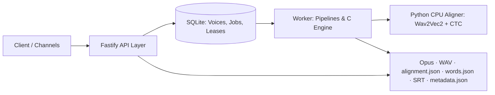

# self-hosted-tts

Private Spanish speech narration service with zero external cloud dependencies: selectable cloned voices, speed and volume control, durable queue, Opus/WAV audio output, and character-level alignment in the canonical ElevenLabs JSON format.

The synthesis engine is [gabriele-mastrapasqua/qwen3-tts](https://github.com/gabriele-mastrapasqua/qwen3-tts), pinned to a specific Git commit. It uses Qwen3-TTS **1.7B Base** to extract reusable speaker profiles and **1.7B CustomVoice** with `--icl-only` for multi-fragment narration. Bracketed SSML/emotion tags are rejected at validation rather than being silently mispronounced or ignored.

---

## Architecture Overview



- **Clean Layered Design**: Encapsulated persistence via repository patterns, decoupled business services, pure domain utilities, and modular worker pipelines.
- **Single Active Worker**: Durable queue with renewable heartbeat leases (`120s`), atomic fencing tokens, and per-fragment checkpoints.
- **Isolated Engine Invocations**: The C engine is invoked via CLI per segment. Speed is handled natively using WSOLA without pitch distortion.
- **Batch Production Focus**: Designed for reliable background long-form narration (up to 30 minutes) rather than real-time low-latency streaming.

---

## Requirements & Production Startup (ARM64)

The worker container requires **Linux ARM64 with ARMv8.2 and DOTPROD** (e.g. Oracle Ampere A1). Development and testing of TypeScript and Python code are supported on macOS. Docker and Docker Compose are required in production.

Reserve ~20 GB free space for model weights, build caches, and initial storage.

```bash
git clone https://github.com/jmcamposdev/self-hosted-tts.git
cd self-hosted-tts
cp .env.example .env
python3 scripts/init-secret.py
python3 scripts/download-tts-models.py
docker compose build
python3 scripts/download-align-model.py
docker compose up -d
docker compose ps
```

- `/health/live`: Probes API process liveness.
- `/health/ready`: Requires both an active worker heartbeat lock and an initialized Python aligner.
- The API listens on **127.0.0.1:8080** by default. Use an SSH tunnel (`ssh -N -L 18080:127.0.0.1:8080 host`) or a reverse HTTPS proxy with authentication to access it remotely.
- Interactive documentation is available at `/docs`.

---

## Creating a Voice & Narrating

Voice references should contain 5–30 seconds of clean speech in an audio file up to 25 MB. No transcription is needed for 1.7B profile extraction. Only use voice references you have explicit rights to utilize.

```bash
# 1. Create a cloned voice profile
python3 scripts/client.py voice-create --name Narrator --audio reference.wav --wait

# 2. List available voices
python3 scripts/client.py voices

# 3. Queue a narration and wait for downloadable artifacts
python3 scripts/client.py narrate --voice-id <VOICE_ID> --text-file narration.txt \
  --speed 1.08 --wait --output ./download
```

The resulting folder contains:

- `audio.opus`: 64 kbps Opus audio.
- `audio.wav`: 24 kHz mono 16-bit master PCM WAV.
- `alignment.json`: Character-level alignment strictly matching ElevenLabs format.
- `words.json`: Word-level start and end timestamps.
- `subtitles.srt`: Generated subtitles with max 42 chars / 6s cues.
- `metadata.json`: Engine commit, hashes, settings, and derived character position indices.

---

## HTTP API Reference

All `/v1` endpoints require an API key passed as `Authorization: Bearer <KEY>` or `xi-api-key: <KEY>`.

| Method & Route                     | Description                                                                                                     |
| ---------------------------------- | --------------------------------------------------------------------------------------------------------------- |
| `POST /v1/voices`                  | Multipart upload with `name`, `audio` and optional `voice_settings` JSON. Returns 202, `voice_id` and `job_id`. |
| `GET /v1/voices`                   | List active voices and default settings.                                                                        |
| `GET /v1/voices/:id`               | Retrieve voice status and configuration.                                                                        |
| `PATCH /v1/voices/:id`             | Update voice name or default settings.                                                                          |
| `DELETE /v1/voices/:id`            | Delete voice and stored profiles. Rejected (409) if active jobs exist.                                          |
| `POST /v1/text-to-speech/:id`      | Queue narration job. Returns 202 and `job_id`.                                                                  |
| `GET /v1/jobs/:id`                 | Check job status, phase, progress, attempts, and error details.                                                 |
| `POST /v1/jobs/:id/cancel`         | Request cancellation of a queued or running job.                                                                |
| `GET /v1/jobs/:id/result`          | Get artifact download URLs upon completion.                                                                     |
| `GET /v1/jobs/:id/artifacts/:name` | Download one of the 6 allowed artifacts.                                                                        |
| `DELETE /v1/jobs/:id`              | Purge finished job or request cancellation + purge.                                                             |

Example payload for `POST /v1/text-to-speech/:id`:

```json
{
  "text": "En el invierno de 1945, ocurrió algo inesperado.",
  "voice_settings": {
    "speed": 1.08,
    "volume": 1.0,
    "paragraph_pause_ms": 250,
    "seed": 42
  }
}
```

---

## Alignment & ElevenLabs Compatibility

`alignment.json` maintains strictly 3 character-level arrays:

```json
{
  "characters": ["H", "o", "l", "a"],
  "character_start_times_seconds": [0.1, 0.15, 0.2, 0.25],
  "character_end_times_seconds": [0.15, 0.2, 0.25, 0.3]
}
```

The timeline is acoustic forced alignment powered by [Wav2Vec2 Spanish](https://huggingface.co/jonatasgrosman/wav2vec2-large-xlsr-53-spanish) and [ctc-segmentation](https://github.com/lumaku/ctc-segmentation). Timings are derived on post-gain audio. Numbers and dates (`dd/mm/yyyy`) are expanded to spoken Spanish before synthesis, and projected back onto the original text positions so that character arrays reproduce the exact input text.

---

## Development & Verification

```bash
# Install dependencies & build
npm ci
npm run build
npm run typecheck

# Run test suite
npm test

# Python aligner environment
python3.11 -m venv .venv
.venv/bin/pip install -r alignment_service/requirements.lock.txt
npm run test:python

# Verify formatting
npm run format:check
```

For more details, see:

- [Architecture & Design](docs/architecture.md)
- [Extension Guide & Recipes](docs/extending.md)
- [Design Decisions & Licenses](docs/decisions.md)
- [Operations & Runbook](docs/operations.md)
- [Validation & Benchmarks](docs/validation.md)
- [Agent Guidelines & Conventions](AGENTS.md)
