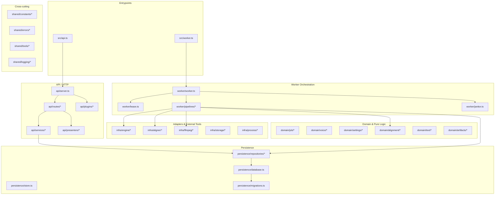

# Arquitectura y Diseño del Sistema

`self-hosted-tts` es un servicio privado asíncrono en español que orquesta síntesis mediante perfiles clonados (motor C `qwen3-tts`) y alineación temporal forzada por carácter compatible con el formato de ElevenLabs.

## Diagrama de Componentes y Capas

## Convenciones de Nomenclatura

- `*.types.ts`: Definición estricta de interfaces y uniones (sin runtime).
- `*.schema.ts`: Esquemas Zod para validación de fronteras (requests, env).
- `*.tools.ts`: Funciones puras y utilidades reutilizables libres de dependencias de negocio.
- `*.repository.ts`: Clases de acceso y mutación a SQLite (encapsulan SQL y transacciones).
- `*.service.ts`: Casos de uso de la aplicación (desacoplados de Fastify).
- `*.routes.ts`: Endpoints HTTP que conectan schemas, services y presenters.
- `*.pipeline.ts`: Flujo de orquestación multietapa para ejecución de trabajos.
- `*.constants.ts`: Constantes canónicas (audio, límites de cuota, identificadores de motor).

## Invariantes Críticos del Sistema

1. **Job Fencing**: Todo trabajo ejecutado por el worker posee un `token` único generado en `claim`. Las operaciones atómicas (`checkpoint`, `finish`, `heartbeat`) verifican dicho token para evitar que un proceso rezagado sobreescriba resultados.
2. **Checkpoints durables**: La síntesis de narraciones divide el guión en fragmentos. Cada fragmento confirmado almacena un `chunk.json` con firma SHA-256 de los parámetros de entrada y checksum del PCM generado, permitiendo recuperación sin duplicación de cálculo.
3. **Snapshots inmutables**: La configuración de la voz y los parámetros solicitados se capturan en el momento del `enqueue` en JSON inmutable. Cambios posteriores en la voz no alteran ejecuciones pendientes o históricas.
4. **Preservación textual de alineación**: La alineación acústica final reconstruye el texto original exactamente con espacios y puntuación, manteniendo monotónica la línea de tiempo e identificando posiciones numéricas expandidas en metadatos.
