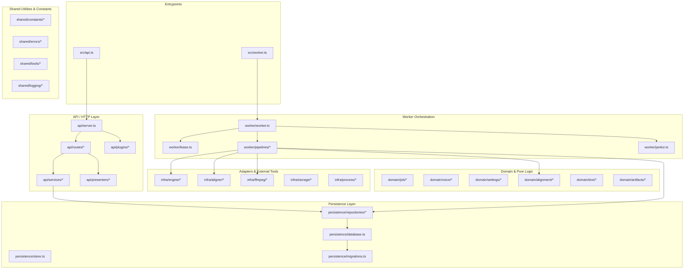

# System Architecture & Design

`self-hosted-tts` is an independent, private asynchronous narration service that coordinates voice cloning profiles via a native C engine (`qwen3-tts`) and character-level forced temporal alignment matching the ElevenLabs JSON format.

## Layer & Component Architecture

## File Suffix Conventions

- `*.types.ts`: Pure TypeScript types and interfaces (no runtime code).
- `*.schema.ts`: Zod validation schemas (`z.infer` exported).
- `*.tools.ts`: Pure, deterministic utility functions free of external side effects.
- `*.repository.ts`: SQLite table queries and mutations (encapsulating SQL).
- `*.service.ts`: Fastify-agnostic application use cases.
- `*.routes.ts`: Fastify HTTP endpoint definitions.
- `*.pipeline.ts`: Worker multi-stage job pipelines.
- `*.constants.ts`: Canonical domain limits, identifiers, and audio parameters.

## Core Invariants

1. **Job Fencing**: Every job claimed by a worker holds an atomic `token` generated during `claim`. State-changing mutations (`checkpoint`, `finish`, `heartbeat`) check this token so stale workers can never overwrite results after a lease loss.
2. **Durable Checkpoints**: Narrations are split into sentences/paragraphs. Each segment generates a checkpoint with input SHA-256 fingerprinting and PCM audio checksums, allowing instant recovery without duplicate calculation.
3. **Immutable Snapshots**: The voice state and request settings are frozen into JSON at enqueue time. Subsequent changes to the voice do not mutate pending or historical jobs.
4. **Text-Preserving Monotonic Alignment**: The public character alignment matches the exact original text (including spaces, symbols, and line breaks). Character timestamps remain strictly monotonic, with expanded number/date positions projected into the metadata.
